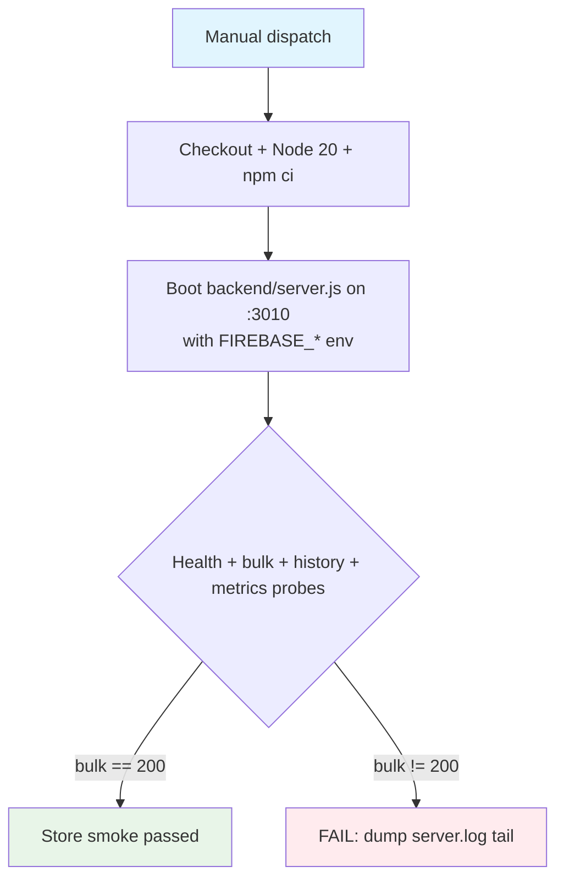

## Workflow Overview

**Purpose**: Prove the Express backend boots against the real Firebase project and serves forecasts strictly out of the Firestore forecast store — the "no second database" gate.
**Trigger Events**: `workflow_dispatch` only (manual diagnostic).
**Target Environments**: Live Firebase project `hazardnet-aas48424` (production Firestore, read-only usage in this workflow).
**Workflow file**: `.github/workflows/Firebase-Store-Verify.yml`.

## Execution Flow Diagram



## Jobs & Dependencies

| Job Name | Purpose | Dependencies | Execution Context |
|----------|---------|--------------|-------------------|
| verify | Boot backend against Firestore, smoke the serving paths | none (single job) | ubuntu-latest, 15 min ceiling |

## Requirements Matrix

### Functional Requirements
| ID | Requirement | Priority | Acceptance Criteria |
|----|-------------|----------|-------------------|
| REQ-001 | Backend reaches `/health` within 30 s of boot | High | Poll loop succeeds; run continues |
| REQ-002 | `/api/v1/forecasts/bulk?horizon=7_days` returns HTTP 200 via Firestore | High | Hard gate; non-200 fails the job |
| REQ-003 | `/api/v1/forecasts/history` serves the default window | Medium | 200-class response sampled (300 bytes) |
| REQ-004 | `/metrics` exposes `hazardnet_forecast_age_hours` | Low | Absence tolerated pre-first-run; only logged |
| REQ-005 | Server log shows the selected forecast-store mode | Medium | `[config]` lines dumped for audit |

### Security Requirements
| ID | Requirement | Implementation Constraint |
|----|-------------|---------------------------|
| SEC-001 | Secrets never printed | Values only enter via env; the step echoes HTTP codes and a log grep, never env |
| SEC-002 | Minimal permissions | `contents: read` only; no write permissions granted to the job |
| SEC-003 | Job-level concurrency guard | `firebase-store-verify-${{ github.ref }}` with cancel-in-progress |
| SEC-004 | Service account hygiene | The three-part credential (project/email/key) must belong to a *dedicated CI* service account — not a user/Owner account |

### Performance Requirements
| ID | Metric | Target | Measurement Method |
|----|--------|--------|-------------------|
| PERF-001 | Wall clock | < 5 min typical, 15 min hard | Runner job duration |

## Input/Output Contracts

### Inputs

```yaml
# Environment Variables (job env, from repository secrets)
FIREBASE_PROJECT_ID: secret    # Purpose: Firestore bootstrap (hazardnet-aas48424)
FIREBASE_CLIENT_EMAIL: secret  # Purpose: service-account identity for firebase-admin
FIREBASE_PRIVATE_KEY: secret   # Purpose: service-account private key (PEM of that identity)
PORT: '3010'                   # Purpose: fixed smoke port for the booted server
```

### Outputs

```yaml
# No formal job outputs; evidence is the step log + pass/fail exit code.
smoke_evidence: log  # health/bulk/history/metrics HTTP codes + [config] store-mode lines
```

### Secrets & Variables

| Type | Name | Purpose | Scope | Value source (owner action) |
|------|------|---------|-------|------------------------------|
| Secret | FIREBASE_PROJECT_ID | Firestore project bootstrap | Repo | `hazardnet-aas48424` |
| Secret | FIREBASE_CLIENT_EMAIL | Admin SDK identity | Repo | `client_email` of the CI service account JSON — use `github-action-1336394594@hazardnet-aas48424.iam.gserviceaccount.com` (purpose-built for this repo's Actions; NOT theOwner/`ashif-ahmed-shuvo@…` account) |
| Secret | FIREBASE_PRIVATE_KEY | Admin SDK signing key | Repo | `private_key` field of that same service account's JSON key (Key ID `bf78ddb9…` or its rotation successor) |
| Variable | PORT | Smoke port | Job-level literal | `3010` (non-secret, hard-coded in workflow) |

## Execution Constraints

### Runtime Constraints
- **Timeout**: 15 min job ceiling (`timeout-minutes: 15`)
- **Concurrency**: one dispatch per ref, cancelling supersedes
- **Resource Limits**: default ubuntu-latest runner; npm cache enabled

### Environmental Constraints
- **Runner Requirements**: Node 20, npm ci over the committed lockfile
- **Network Access**: Firestore egress (`*.googleapis.com`), npm registry on first install
- **Permissions**: `contents: read` only

## Error Handling Strategy

| Error Type | Response | Recovery Action |
|------------|----------|-----------------|
| Missing/mapped-wrong secret | Backend fails readiness or Firestore auth; bulk != 200 | Fix secret values, re-dispatch |
| Firestore empty pre-first-run | metrics gauge absent (logged, tolerated) | Run the daily ingest once |
| Backend crash on boot | Readiness loop exhausts, bulk probe fails | `server.log` tail printed; fix boot root cause |

## Quality Gates

| Gate | Criteria | Bypass Conditions |
|------|----------|-------------------|
| Store serving | bulk endpoint == HTTP 200 | None — hard gate |

## Monitoring & Observability

- **Success Rate**: expect ~100 % on dispatch (diagnostic, not a schedule)
- **Execution Time**: < 5 min
- **Alerting**: none; manual invocation ⇒ manual reading of the log

## Integration Points

| System | Integration Type | Data Exchange | SLA Requirements |
|--------|------------------|---------------|------------------|
| Firestore (`hazardnet-aas48424`) | Admin SDK reads | Forecast documents | Default Firestore SLA; read-only here |

### Dependent Workflows
| Workflow | Relationship | Trigger Mechanism |
|----------|--------------|-------------------|
| daily_advisory_ingest | Writes the store this workflow reads | cron `30 5 * * *` |

## Compliance & Governance

- **Execution Logs**: retained per repo Actions retention policy
- **Secret Management**: rotation via `scripts/check-secret-rotation.mjs` + `secret-rotation-audit.yml`; the private key is the rotation unit (create new SA key → update 3 secrets → delete old Key ID in GCP console)

## Edge Cases & Exceptions

| Scenario | Expected Behavior | Validation Method |
|----------|-------------------|-------------------|
| Private key pasted with `\n` escapes | Backend normalizes before use (verify-secrets workflow checks shape) | Dispatch verify-secrets first |
| Wrong client_email / project mismatch | Admin SDK auth failure at boot | Fails the hard gate quickly |
| Key created for a *different* SA than the email secret points to | 4xx from Google IAM | Match email↔key from ONE JSON file |

## Validation Criteria

- **VLD-001**: Job exits 0 ⇒ Firestore serving is live
- **VLD-002**: `[config]` log line shows the Firestore forecast-store mode

## Change Management

1. Update this specification first when the store surface changes.
2. Mirror any new secret reference in `verify-secrets.yml`'s expected set (that workflow statically audits workflow secret references).

### Version History
| Version | Date | Changes | Author |
|---------|------|---------|--------|
| 1.0 | 2026-10-25 | Initial specification | HazardNet |

## Related Specifications

- `spec-process-cicd-daily-advisory-ingest.md` (the writer of the store this verifies)
